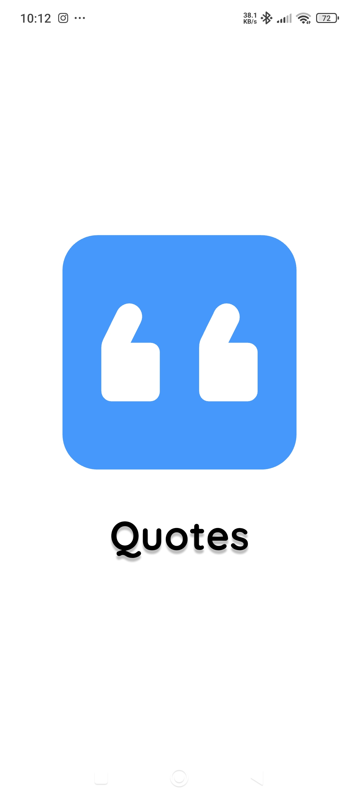
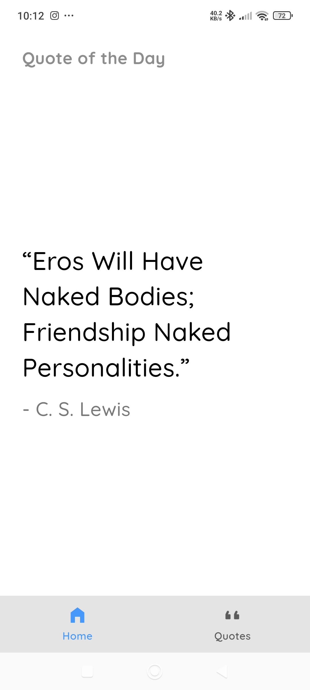
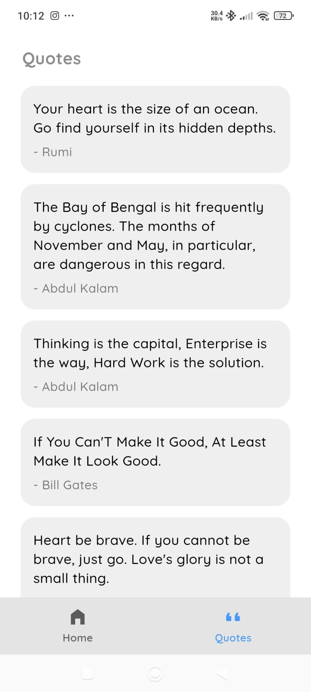
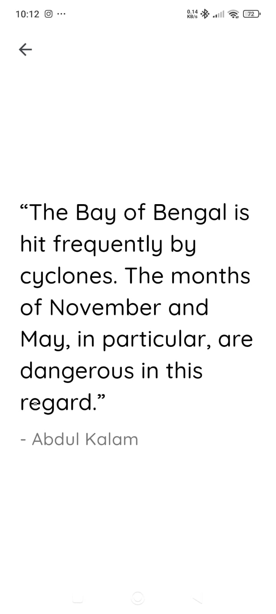

# Quotes App

A Flutter app built from the provided Figma design, using the [DummyJSON quotes API](https://dummyjson.com/docs/quotes). This branch uses **Clean Architecture** and **Bloc**.

## Features

| Screen | What it does |
| --- | --- |
| Splash | App icon and title for 2 seconds, then fades into the app |
| Home | "Quote of the Day" from `GET /quotes/random`. Pull down to load another quote |
| Quotes | List from `GET /quotes?limit=20&skip=N` that loads more quotes as you scroll |
| Quote Explore | Detail screen for the quote you tapped |

- Loading, error (with a Retry button) and empty states on every network screen.
- If a pull-to-refresh fails, the current quote stays on screen and a message is shown.
- If loading the next page fails, the existing list stays and an inline "tap to retry" appears.
- The Android back button on the Quotes tab returns to Home first.

## Screenshots

| Splash | Home | Quotes | Quote Explore |
| --- | --- | --- | --- |
|  |  |  |  |

## Requirements

- Flutter 3.47.5 (stable) with Dart 3.13.4
- An Android emulator or device

## Running the app

```bash
flutter pub get
flutter run
flutter test
flutter analyze
```

To generate the launcher icons from `assets/icon/`:

```bash
dart run flutter_launcher_icons
```

The `INTERNET` permission is declared in `android/app/src/main/AndroidManifest.xml`.

## Packages

| Package | Used for |
| --- | --- |
| `flutter_bloc` | State management (Bloc, `BlocBuilder`, `BlocListener`) |
| `bloc_concurrency` | `droppable()` event transformer to ignore duplicate requests |
| `equatable` | Value equality for entities, events, states and failures |
| `get_it` | Dependency injection (service locator) |
| `http` | HTTP requests |
| `google_fonts` | Quicksand typeface from the design |
| `bloc_test`, `mocktail` (dev) | Testing |
| `flutter_launcher_icons`, `flutter_lints` (dev) | Icons and lint rules |

## Architecture

Feature-first folders, with the Clean Architecture layers inside the `quotes` feature.

```
lib/
  main.dart                     entry point
  app.dart                      MaterialApp and Bloc providers
  injection_container.dart      get_it setup (the composition root)
  core/
    constants/                  API constants
    error/                      exceptions (data layer) and failures (domain layer)
    network/                    ApiClient (HTTP, timeouts, error translation)
    result/                     Result, Ok and Err
    theme/                      colours, text styles, theme
    usecase/                    UseCase interface
    widgets/                    logo, error view, screen title
  features/
    splash/presentation/screens/
    shell/presentation/screens/       bottom navigation and tabs
    quotes/
      domain/
        entities/                     Quote, QuotesPage
        repositories/                 QuoteRepository (interface)
        usecases/                     GetRandomQuote, GetQuotesPage
      data/
        models/                       JSON-aware subclasses of the entities
        datasources/                  QuoteRemoteDataSource (interface + implementation)
        repositories/                 QuoteRepositoryImpl
      presentation/
        bloc/                         RandomQuoteBloc, QuotesBloc
        screens/                      home, quotes, quote detail
        widgets/                      quote card, quote display
test/                                 mirrors lib/
```

**Dependency rule:** presentation depends on domain, data depends on domain, and domain depends on nothing. Errors travel as exceptions inside the data layer, become `Failure` values in the repository, and reach the UI as part of Bloc state.

### Request flow

```
Screen -> Bloc event -> Bloc -> UseCase -> Repository (interface)
       -> RepositoryImpl -> RemoteDataSource -> ApiClient -> DummyJSON
```

The response comes back as a `Result<T>` (`Ok` or `Err`), the Bloc emits a new state, and `BlocBuilder` redraws the screen.

## State management

- `RandomQuoteBloc` drives Home and `QuotesBloc` drives the Quotes list. Events and states are sealed or value-comparable classes using `Equatable`.
- Both Blocs use `droppable()`, so a second request while one is running is ignored.
- `QuotesBloc` also ignores next-page requests when nothing is left, or while a failed page waits for an explicit retry, so scroll events can't flood the server.
- Screens use `BlocBuilder` to draw state and `BlocListener` for one-off effects (the refresh-failed snackbar).
- Blocs are created by `BlocProvider` in `app.dart`, resolved from `get_it`, and created lazily, so the Quotes list is requested when its tab is first opened.

## Design patterns and SOLID

| Idea | Where |
| --- | --- |
| Single responsibility | Data source fetches, repository translates errors, use case is one action, Bloc holds screen state |
| Open/closed | New data sources or use cases are added without editing existing ones |
| Liskov substitution | `QuoteModel` stands in for `Quote`, and mocks stand in for use cases and data sources |
| Interface segregation | Small interfaces: `UseCase`, `QuoteRepository`, `QuoteRemoteDataSource` |
| Dependency inversion | Blocs and use cases depend on abstractions, and `get_it` supplies the implementations |
| Repository pattern | `QuoteRepository` hides where data comes from |
| Use case (command) | `GetRandomQuote`, `GetQuotesPage` |
| Observer | Bloc state streams with `BlocBuilder` and `BlocListener` |
| Factory and singleton | `fromJson` factories, and `get_it` lazy singletons and factories |
| Result type | `Result<T>` (`Ok` or `Err`) keeps exceptions out of the domain and UI |

## Testing

29 tests, mirroring the `lib/` layers:

- `bloc_test` for both Blocs (loading, success, failure, refresh keeping the current quote, pagination, retry).
- Repository tests with a mocked data source, checking every error-to-failure mapping.
- `ApiClient` tests with `MockClient` (URL building, status codes, bad JSON, offline, timeout).
- Model, use case and widget tests.

## Design notes

- Colours were sampled from the Figma screenshot, and sizes and spacing were measured from it (360 x 800 artboard).
- The splash logo is drawn in code (`core/widgets/app_logo.dart`). The launcher icon PNGs are in `assets/icon/`.
- Quicksand is loaded through `google_fonts`, so the first launch needs a network connection.

## Known limitations

- No offline cache: without a connection the app shows the error state with Retry.
- The Quotes list has no pull-to-refresh.
- Only the light theme from the design is implemented.