# Quotes App

A Flutter app built from the provided Figma design. It shows a quote of the day and a browsable list of quotes from the [DummyJSON quotes API](https://dummyjson.com/docs/quotes).

## Features

| Screen | What it does |
| --- | --- |
| Splash | App icon and title for 2 seconds, then fades into the app |
| Home | "Quote of the Day" from `GET /quotes/random`. Pull down to load another quote |
| Quotes | List from `GET /quotes?limit=20&skip=N` that loads more quotes as you scroll |
| Quote Explore | Detail screen for the quote you tapped, opened with the back arrow to return |

- Loading, error (with a Retry button) and empty states on every network screen.
- If a pull-to-refresh fails, the current quote stays on screen and a message is shown.
- If loading the next page fails, the existing list stays and an inline "tap to retry" appears.
- The Android back button on the Quotes tab returns to Home first.

## Screenshots

| Splash | Home | Quotes | Quote Explore |
| --- | --- | --- | --- |
| 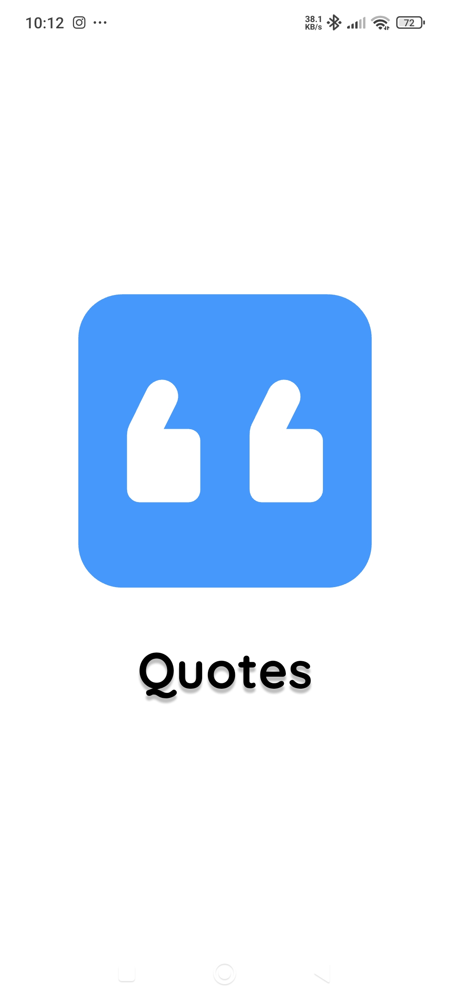 | 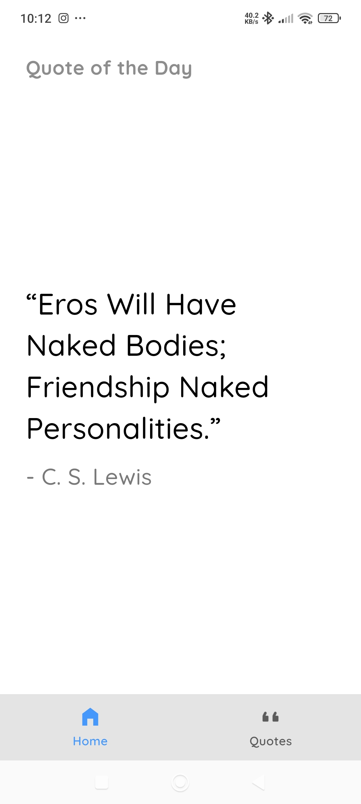 | 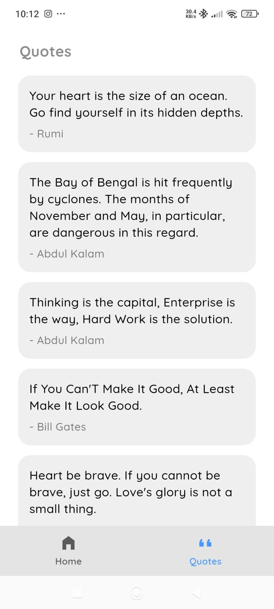 | 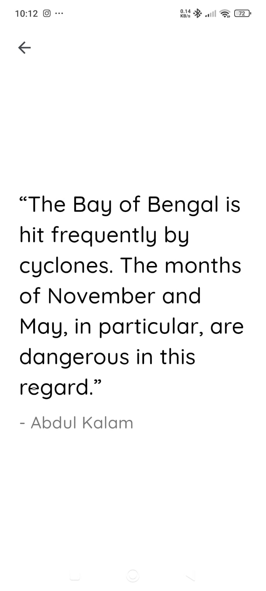 |

Pull-to-refresh and offline handling:

| Refresh | Offline (Home) | Offline (Quotes) |
| --- | --- | --- |
| 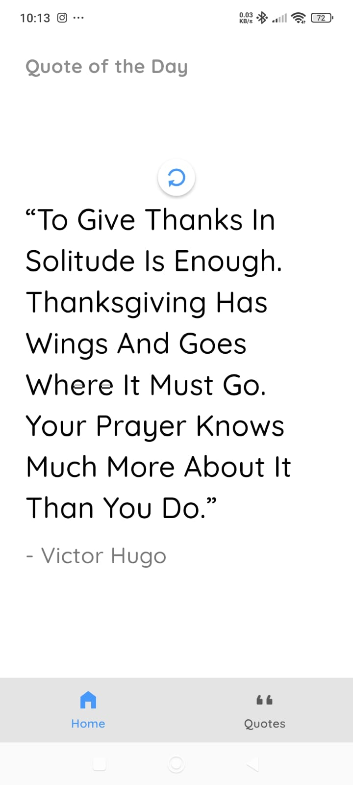 | 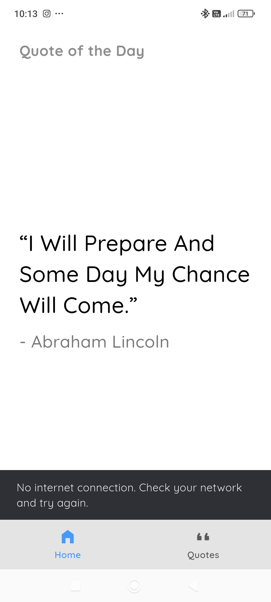 | 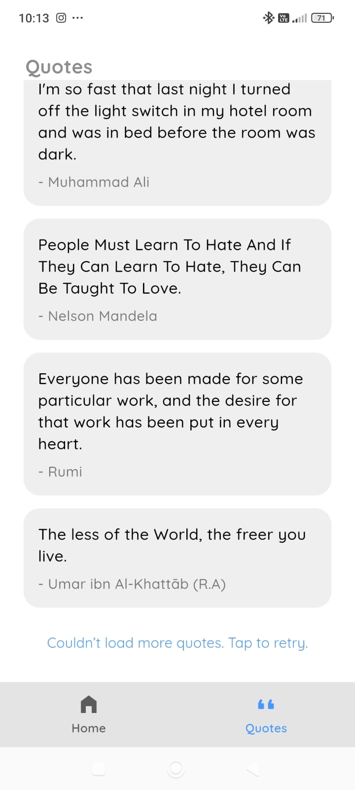 |

## Verification

Tested on Android in debug mode with Flutter 3.47.5 (Dart 3.13.4).

- `flutter analyze` reports no issues, and `flutter test` passes all 12 tests.
- DevTools shows the app calling `/quotes/random` and `/quotes?limit=20&skip=0`, then `skip=20` and `skip=40` as the list is scrolled.

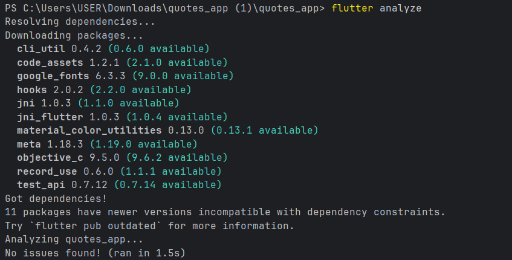
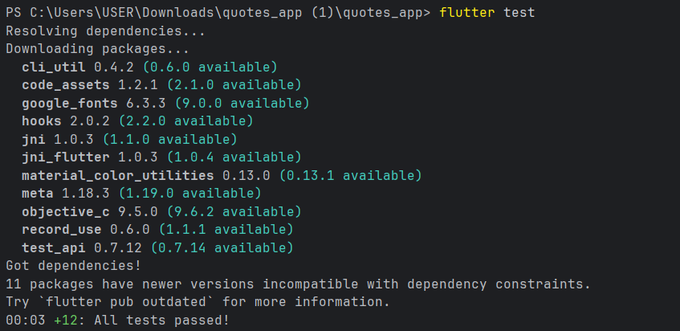
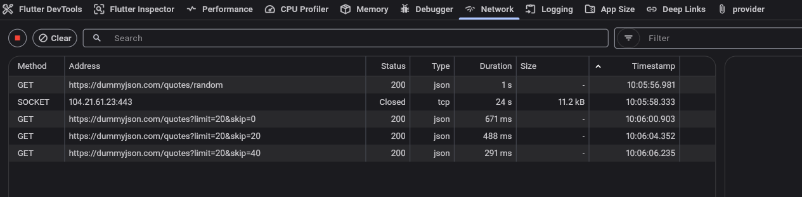
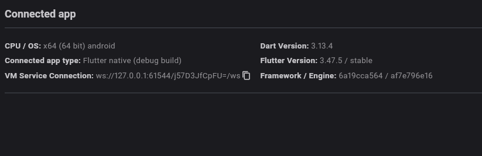

## Requirements

- Flutter 3.47.5 (stable) with Dart 3.13.4
- An Android emulator or device (or any other Flutter-supported device)

## Running the app

```bash
flutter pub get
flutter run
```

To generate the launcher icons from `assets/icon/`:

```bash
dart run flutter_launcher_icons
```

To run the tests and static analysis:

```bash
flutter test
flutter analyze
```

The `INTERNET` permission is declared in `android/app/src/main/AndroidManifest.xml`, so release builds can reach the API.

## Packages

| Package | Used for |
| --- | --- |
| `provider` | State management and dependency injection |
| `http` | HTTP requests |
| `google_fonts` | Quicksand typeface from the design |
| `flutter_launcher_icons` (dev) | Launcher icon generation |
| `flutter_lints` (dev) | Lint rules |

## Project structure

```
lib/
  main.dart                          entry point, Provider setup, MaterialApp
  theme/app_theme.dart               colours, text styles, theme
  models/quote.dart                  Quote and QuotesPage (JSON parsing)
  services/quote_service.dart        HTTP calls to DummyJSON, ApiException
  providers/
    quote_of_the_day_provider.dart   Home state
    quotes_provider.dart             Quotes list state and pagination
  screens/                           splash, main (bottom navigation), home, quotes, quote detail
  widgets/                           quote card, quote display, logo, error view, screen title
test/                                model, provider and widget tests
```

## State management

- `main.dart` registers a plain `Provider<QuoteService>` and two `ChangeNotifierProvider`s. The providers receive the service through `context.read` when they are created.
- Providers are lazy: Home's quote is requested when Home is first built, and the Quotes list when the Quotes tab is first opened.
- Screens use `context.watch` for the state they display and `context.read` for actions (retry, refresh, load more).
- Providers depend on `QuoteService` only, never on `http` directly, so the tests replace it with a fake service and need no network.
- `QuotesProvider.loadMore()` is safe to call on every scroll event. It does nothing while a request is running, when no pages remain, or while a failed page waits for a retry.

## Design notes

- Colours were sampled from the Figma screenshot, and font sizes, spacing and radii were measured from it (360 x 800 artboard).
- The splash logo is drawn in code (`widgets/app_logo.dart`) so it stays sharp at any size. The launcher icon PNGs are in `assets/icon/`.
- Quicksand is loaded through `google_fonts`, so the first launch needs an internet connection. The font is cached afterwards.

## Known limitations

- No offline cache: without a connection the app shows the error state with Retry.
- The Quotes list has no pull-to-refresh (Home has it).
- Only the light theme from the design is implemented.